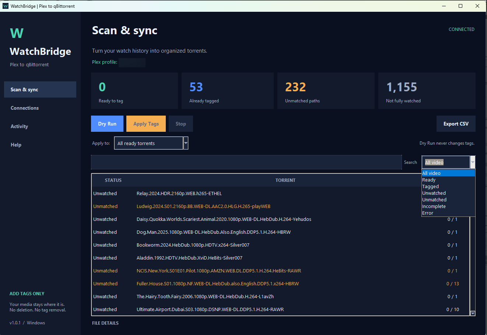
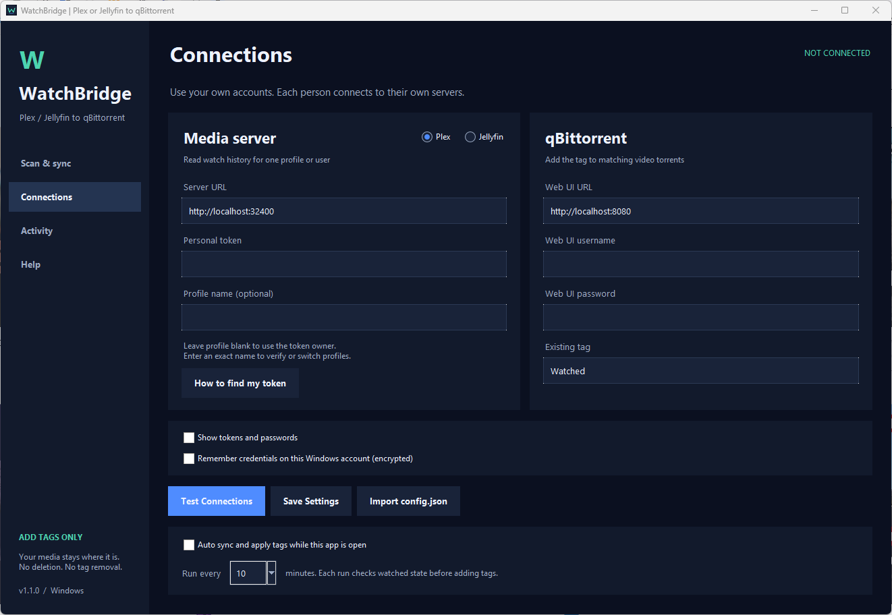
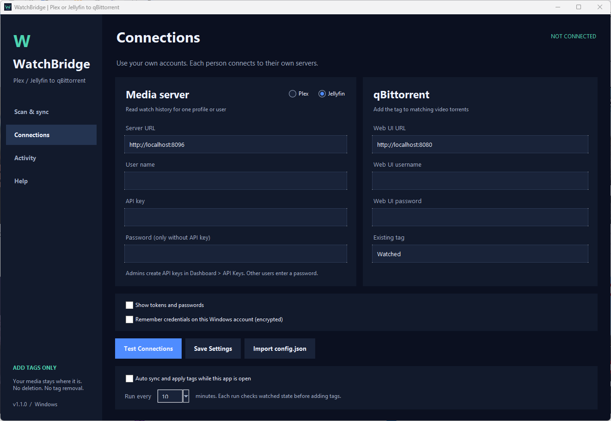
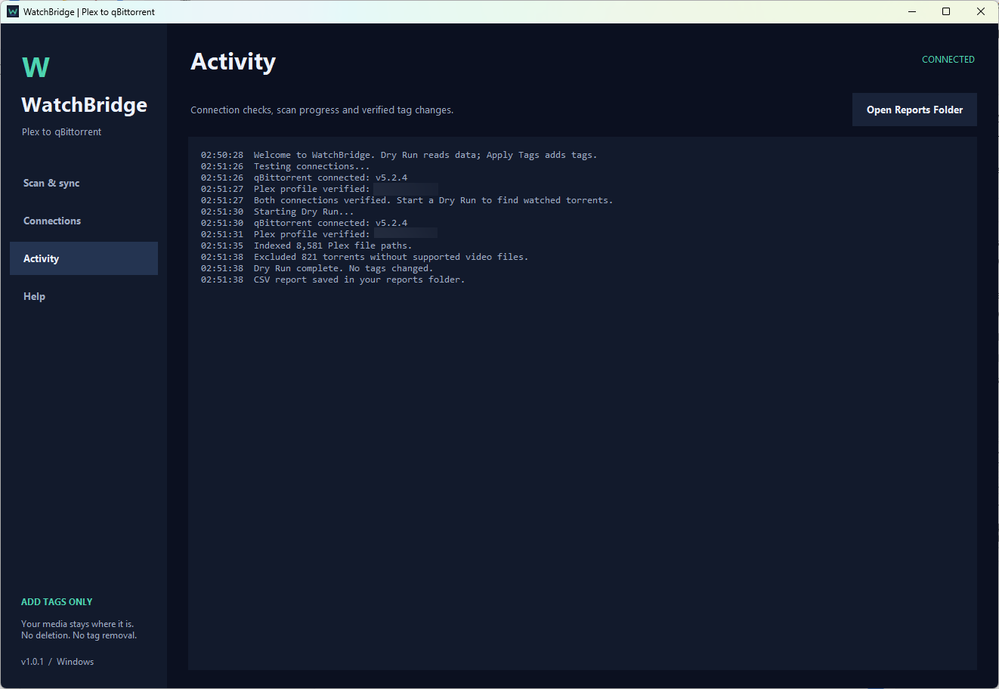
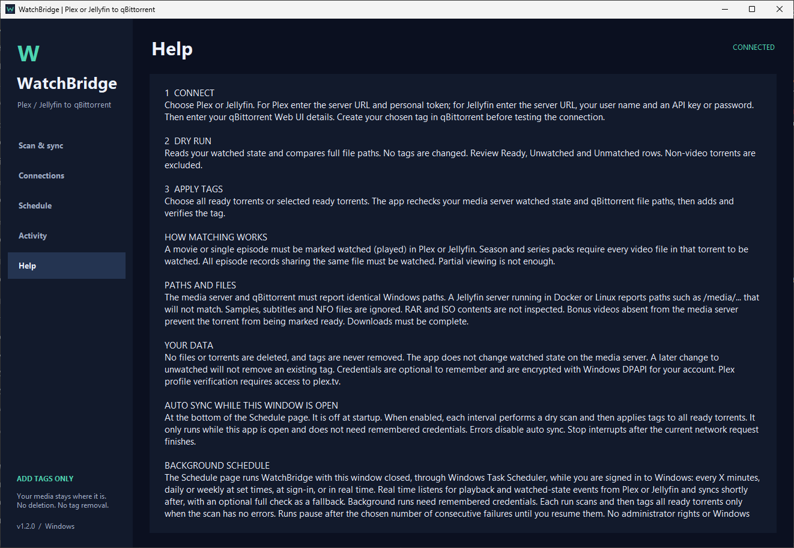

# WatchBridge

[עברית](README.he.md) | English

A Windows desktop GUI for adding a qBittorrent tag based on one Plex or Jellyfin user's watched state.

## Screenshots

### Scan, results and filtering



### Connections: Plex or Jellyfin

| Plex | Jellyfin |
| --- | --- |
|  |  |

<details>
<summary>Activity and help</summary>

### Activity and reports



### Help and matching rules



</details>

## Run

Install Python 3.10+ with the Python Launcher, extract the source ZIP, and double-click `RUN.bat`.
It creates a private virtual environment and installs the two dependencies if needed.
The interface is entirely in English.

## Build for sharing

On Windows, double-click `BUILD_EXE.bat`. The output is `dist/WatchBridge-Windows.zip`,
containing a self-contained `WatchBridge.exe` and user instructions. Share that ZIP.
The source package does not contain a prebuilt Windows EXE. PyInstaller builds target
the OS where they are run. The EXE is unsigned.

## Features

- Dry Run with no tag changes; Apply Tags for all ready or selected ready torrents.
- Background workers, progress, safe cancellation, filters, search and per-torrent details.
- CSV export and automatic reports, excluding non-video torrents.
- Exact file matching, including season packs and multiple episodes in one file.
- Plex and Jellyfin media servers, chosen in Connections.
- Profile or user verification and support for qBittorrent's empty HTTP 200/204 login replies.
- Optional Windows DPAPI credential storage. No personal account is bundled.
- Optional in-app auto sync; off at every startup, errors stop automatic runs.
- Import existing `config.json` from the earlier command-line version.
- Right-click Cut/Copy/Paste/Select All and keyboard shortcuts, including Hebrew Windows keyboard layouts.

## Matching rules

The media server (Plex or Jellyfin) and qBittorrent must report identical Windows paths.
Every non-sample video in a torrent must map to watched (played) media server records, and downloads must be complete. Missing
videos and bonus clips block tagging. Subtitles and non-video files are ignored.
The app adds one existing tag, and does not delete anything or remove existing tags.

## Validation

`python -m unittest discover -s tests -v`

The test suite uses fake APIs to cover matching, pagination, profile selection,
new/old login responses, error handling, report filtering, cancellation and add-only
tag updates, Jellyfin login and library paging, and clipboard editing with Hebrew Windows layouts. All 40 tests pass
without live server access. Windows EXE packaging, native DPAPI
encryption and native GUI appearance require verification on Windows.

Read `README_USER.txt` for complete behavior and setup instructions.

## Connection setup

Enable qBittorrent's Web UI and create your desired tag, usually `Watched`.
In **Connections**, choose **Plex** or **Jellyfin** and enter its details, plus the
qBittorrent Web UI URL, username and password. Example local addresses:

```text
Plex:        http://localhost:32400
Jellyfin:    http://localhost:8096
qBittorrent: http://localhost:8080
```

Replace `localhost` if the services run on another machine. Leave **Profile name**
blank to use the token's account, or enter an exact profile name for verification
or switching. The app does not combine different users' watch histories.
See [Plex's official token instructions](https://support.plex.tv/articles/204059436-finding-an-authentication-token-x-plex-token/).

### Jellyfin

Enter the server URL and your exact Jellyfin user name. Then either:

- enter an **API key**. A Jellyfin administrator creates one in **Dashboard > API Keys**; or
- leave the API key blank and enter that user's **password**.

Only that user's played state is read. Jellyfin counts an item as played after it is
watched nearly to the end, or when it is marked played manually.

Jellyfin often runs in Docker or on Linux and then reports paths such as
`/media/movies/...`. Those do not match the Windows paths in qBittorrent, so every
video shows as **Unmatched**. Both services must report the same Windows paths.

## Results and daily use

Click **Test Connections**, then **Dry Run**. Review results before **Apply Tags**.
Choose **All ready torrents** or select rows with Ctrl/Shift and choose
**Selected ready torrents**. Changing connection details requires a fresh scan.

| Status | Meaning |
| --- | --- |
| Ready | Every relevant video is matched, watched and fully downloaded. |
| Tagged | The chosen tag is already present. |
| Unwatched | At least one matched video is not marked watched. |
| Unmatched | At least one video path is absent from the media server. |
| Incomplete | Watched videos are not fully downloaded yet. |
| Error | An API request failed. Resolve it and scan again before tagging. |

**Export CSV** saves all video results, independent of table filters. Automatic
reports are accessible through **Activity > Open Reports Folder**. Non-video
torrents are excluded from the table and reports.

Optional auto sync scans and applies tags to all ready torrents at your chosen
interval, while the app is open. It starts disabled, ignores table selections and
filters, and stops on errors. Stop takes effect after the current network request;
tags already added remain. Existing tags are never removed when a title becomes
unwatched on the media server.

## Privacy

Settings and reports are stored outside the application folder:

```text
%LOCALAPPDATA%\WatchBridge\settings.json
%LOCALAPPDATA%\WatchBridge\reports\
```

Credentials stay in memory unless **Remember credentials** is enabled. On Windows,
remembered secrets are encrypted for the current user with DPAPI. Other connection
settings are plain JSON. Disable the option and save to remove stored secrets.
Personal Plex profile verification contacts `plex.tv`; Jellyfin and other service
operations go only to the URLs you enter. No application telemetry is implemented.

Do not commit personal configs, reports or private screenshots. `.gitignore`
excludes personal settings, reports, Python environments, caches and build outputs.
Share the generated ZIP, without your own account data.

## License

[MIT](LICENSE). This project is independent of Plex, Jellyfin and qBittorrent.
