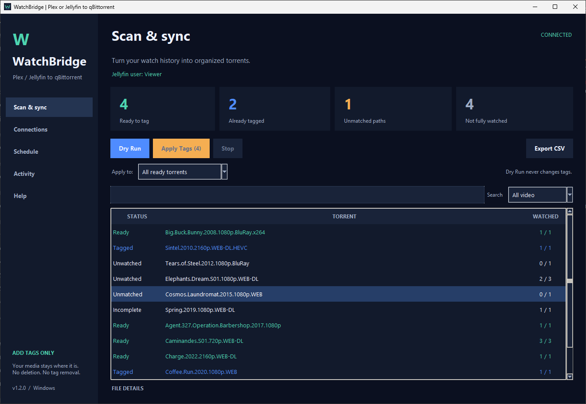
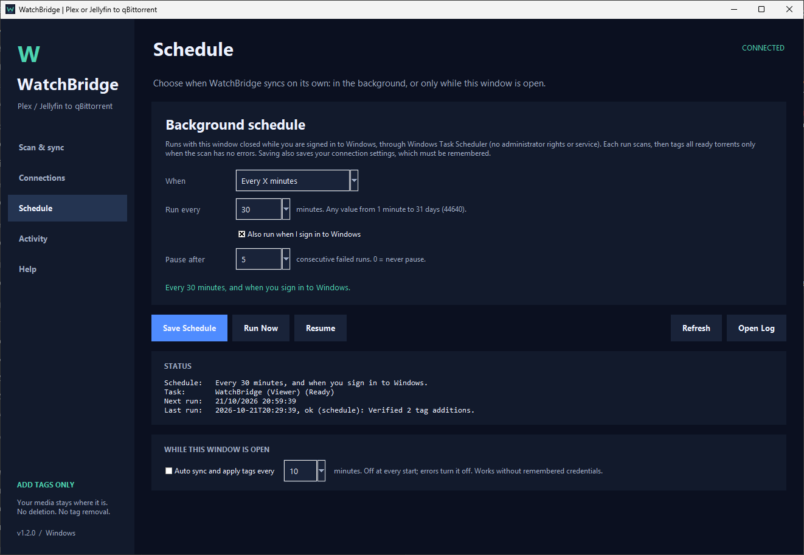
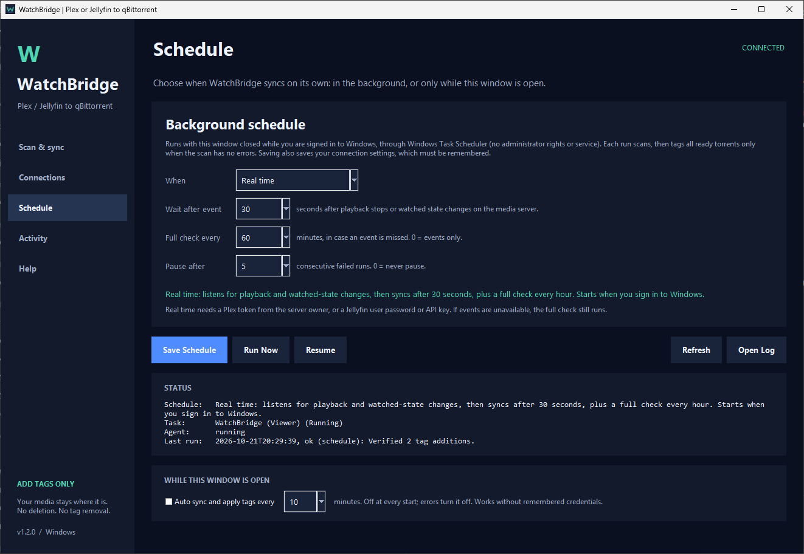

# WatchBridge

[עברית](README.he.md) | English

A Windows desktop GUI and command line for adding a qBittorrent tag based on one Plex or Jellyfin
user's watched state. It can run on demand, on a background schedule, or in real time.

## Screenshots

All screenshots use demo data.

### Scan, results and filtering



### Background schedule

| Every X minutes | Real time |
| --- | --- |
|  |  |

### Connections: Plex or Jellyfin

| Plex | Jellyfin |
| --- | --- |
|  |  |

<details>
<summary>Activity and help</summary>

### Activity and reports


### Help and matching rules


</details>

## Run

Install Python 3.10+ with the Python Launcher, extract the source ZIP, and double-click `RUN.bat`.
It creates a private virtual environment and installs the two dependencies if needed.
The interface is entirely in English.

## Build for sharing

On Windows, double-click `BUILD_EXE.bat`. The output is `dist/WatchBridge-Windows.zip`,
containing a self-contained `WatchBridge.exe` (window and background runs), `WatchBridgeCLI.exe`
(command line) and user instructions. Share that ZIP.
The source package does not contain a prebuilt Windows EXE. PyInstaller builds target
the OS where they are run. The EXE is unsigned.

## Features

- Dry Run with no tag changes; Apply Tags for all ready or selected ready torrents.
- Background workers, progress, safe cancellation, filters, search and per-torrent details.
- CSV export and automatic reports, excluding non-video torrents.
- Exact file matching, including season packs and multiple episodes in one file.
- Plex and Jellyfin media servers, chosen in Connections.
- Profile or user verification and support for qBittorrent's empty HTTP 200/204 login replies.
- Optional Windows DPAPI credential storage. No personal account is bundled.
- Optional in-app auto sync; off at every startup, errors stop automatic runs.
- Background schedule with the window closed: every X minutes, daily or weekly at set times,
  at Windows sign-in, or real time on Plex/Jellyfin playback and watched-state events.
- Full command line (`WatchBridgeCLI`) with every option from the window, for scripts and terminals.
- Import existing `config.json` from the earlier command-line version.
- Right-click Cut/Copy/Paste/Select All and keyboard shortcuts, including Hebrew Windows keyboard layouts.

## Matching rules

The media server (Plex or Jellyfin) and qBittorrent must report identical Windows paths.
Every non-sample video in a torrent must map to watched (played) media server records, and downloads must be complete. Missing
videos and bonus clips block tagging. Subtitles and non-video files are ignored.
The app adds one existing tag, and does not delete anything or remove existing tags.

## Validation

`python -m unittest discover -s tests -v`

The test suite uses fake APIs to cover matching, pagination, profile selection,
new/old login responses, error handling, report filtering, cancellation and add-only
tag updates, Jellyfin login and library paging, and clipboard editing with Hebrew Windows layouts.
It also covers schedule parsing, Task Scheduler XML, the run lock, failure pause and resume,
real-time event handling, the agent loop and every command-line command. All 80 tests pass
without live server access. Native GUI appearance and live Plex events require verification on Windows
with real servers.

Read `README_USER.txt` for complete behavior and setup instructions.

## Connection setup

Enable qBittorrent's Web UI and create your desired tag, usually `Watched`.
In **Connections**, choose **Plex** or **Jellyfin** and enter its details, plus the
qBittorrent Web UI URL, username and password. Example local addresses:

```text
Plex:        http://localhost:32400
Jellyfin:    http://localhost:8096
qBittorrent: http://localhost:8080
```

Replace `localhost` if the services run on another machine. Leave **Profile name**
blank to use the token's account, or enter an exact profile name for verification
or switching. The app does not combine different users' watch histories.
See [Plex's official token instructions](https://support.plex.tv/articles/204059436-finding-an-authentication-token-x-plex-token/).

### Jellyfin

Enter the server URL and your exact Jellyfin user name. Then either:

- enter an **API key**. A Jellyfin administrator creates one in **Dashboard > API Keys**; or
- leave the API key blank and enter that user's **password**.

Only that user's played state is read. Jellyfin counts an item as played after it is
watched nearly to the end, or when it is marked played manually.

Jellyfin often runs in Docker or on Linux and then reports paths such as
`/media/movies/...`. Those do not match the Windows paths in qBittorrent, so every
video shows as **Unmatched**. Both services must report the same Windows paths.

## Results and daily use

Click **Test Connections**, then **Dry Run**. Review results before **Apply Tags**.
Choose **All ready torrents** or select rows with Ctrl/Shift and choose
**Selected ready torrents**. Changing connection details requires a fresh scan.

| Status | Meaning |
| --- | --- |
| Ready | Every relevant video is matched, watched and fully downloaded. |
| Tagged | The chosen tag is already present. |
| Unwatched | At least one matched video is not marked watched. |
| Unmatched | At least one video path is absent from the media server. |
| Incomplete | Watched videos are not fully downloaded yet. |
| Error | An API request failed. Resolve it and scan again before tagging. |

**Export CSV** saves all video results, independent of table filters. Automatic
reports are accessible through **Activity > Open Reports Folder**. Non-video
torrents are excluded from the table and reports.

Optional auto sync, under **Schedule > While this window is open**, scans and applies tags to
all ready torrents at your chosen interval while the app is open, without remembered
credentials. It starts disabled, ignores table selections and
filters, and stops on errors. Stop takes effect after the current network request;
tags already added remain. Existing tags are never removed when a title becomes
unwatched on the media server.

## Background schedule

The **Schedule** page runs WatchBridge with the window closed, while you are signed in to Windows.
It registers one task for your Windows account in Windows Task Scheduler. It does not need
administrator rights, a Windows service, or a stored Windows password.

| Mode | Runs |
| --- | --- |
| Every X minutes | Every 1 minute to 31 days, for example every 30 minutes. |
| Daily at set times | At one or more times each day, for example `03:00, 15:30`. |
| Weekly on set days | On chosen days at chosen times, for example Sun to Thu at 22:30. |
| At Windows sign-in | Once each time you sign in. |
| Real time | Listens for Plex or Jellyfin events and syncs shortly after playback stops or watched state changes. |

Interval, daily and weekly modes can also run at sign-in. Real time starts at sign-in, waits a
few seconds after the last event (30 by default), and runs an optional full check every N
minutes in case an event is missed. Plex events need a token from the server owner. Jellyfin
events use the user's password or an API key. If events are unavailable, the full check still runs.

Every background run scans first. It tags all ready torrents only when the scan has no errors.
Runs never overlap, including with the window. After a set number of consecutive failures
(5 by default) background runs pause until you click **Resume**. Background runs need
**Remember credentials**. **Run Now** starts a run immediately, and **Open Log** shows background
activity. If you move WatchBridge to another folder, click **Save Schedule** again.

## Command line

Every option in the window is also available from `WatchBridgeCLI.exe`, or from
`WatchBridgeCLI.bat` in the source package. Run `WatchBridgeCLI --help` or
`WatchBridgeCLI <command> --help` for details.

```text
WatchBridgeCLI test                                    Test Connections
WatchBridgeCLI scan [--status ready,unmatched] [--search TEXT] [--details] [--json] [--csv FILE]
WatchBridgeCLI apply [--name TEXT] [--hash HASH]       Apply Tags (all ready, or a selection)
WatchBridgeCLI sync                                    Scan, then tag all ready torrents
WatchBridgeCLI auto --interval 15                      Auto sync while the command runs
WatchBridgeCLI config show | set | import FILE | clear-credentials | path
WatchBridgeCLI schedule set interval --every 30m --at-logon
WatchBridgeCLI schedule set daily --at 03:00,15:30
WatchBridgeCLI schedule set weekly --days sun-thu --at 22:30
WatchBridgeCLI schedule set logon
WatchBridgeCLI schedule set realtime --delay 30 --fallback 60
WatchBridgeCLI schedule show | run | resume | off
WatchBridgeCLI agent [--status | --run-now | --stop]   Real-time agent
WatchBridgeCLI reports [--open] [--list N]
WatchBridgeCLI logs [--tail N] [--follow] [--open]
WatchBridgeCLI guide | gui | --version
```

Connection options override saved settings for one run: `--server plex|jellyfin`, `--plex-url`,
`--plex-token`, `--plex-profile`, `--jf-url`, `--jf-user`, `--jf-api-key`, `--jf-password`,
`--qb-url`, `--qb-user`, `--qb-password`, `--tag` and `--config FILE`. Add `--save`, with
`--remember` or `--no-remember`, to store them. For secrets, pass `-` to be prompted, or set
`WATCHBRIDGE_PLEX_TOKEN`, `WATCHBRIDGE_JF_API_KEY`, `WATCHBRIDGE_JF_PASSWORD` or
`WATCHBRIDGE_QB_PASSWORD`, so that they do not appear in the process list.

Exit codes: `0` success, `1` failure or scan errors, `2` invalid input, `3` another run in
progress, `4` background runs paused, `130` stopped.

## Privacy

Settings and reports are stored outside the application folder:

```text
%LOCALAPPDATA%\WatchBridge\settings.json
%LOCALAPPDATA%\WatchBridge\reports\
%LOCALAPPDATA%\WatchBridge\logs\
%LOCALAPPDATA%\WatchBridge\schedule-state.json
```

Credentials stay in memory unless **Remember credentials** is enabled. On Windows,
remembered secrets are encrypted for the current user with DPAPI. Other connection
settings are plain JSON. Disable the option and save to remove stored secrets.
Personal Plex profile verification contacts `plex.tv`; Jellyfin and other service
operations go only to the URLs you enter. No application telemetry is implemented.

Do not commit personal configs, reports or private screenshots. `.gitignore`
excludes personal settings, reports, Python environments, caches and build outputs.
Share the generated ZIP, without your own account data.

## License

[MIT](LICENSE). This project is independent of Plex, Jellyfin and qBittorrent.
